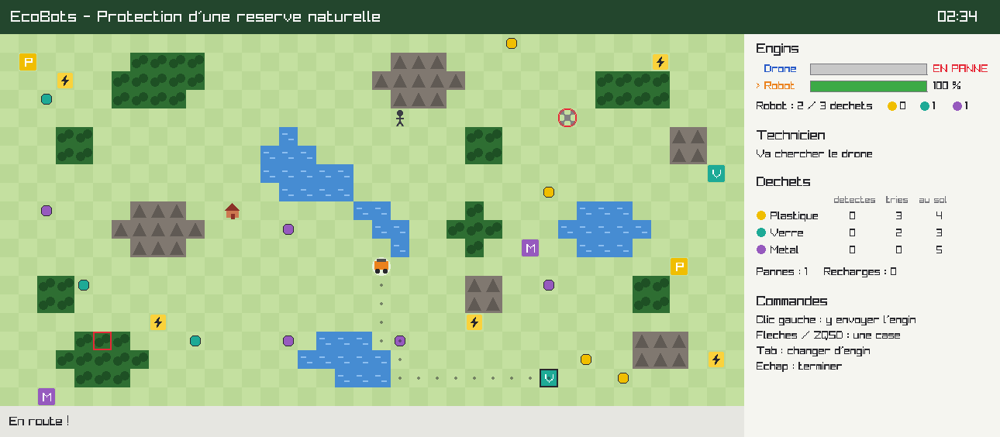

# EcoBots — Protection d'une réserve naturelle

Projet Informatique 1 — ING1 ECE Paris, semestre 1 2026-2027.

**Équipe :** Joe Humler-Payet, Alexandre Augiers de Crémiers, Ossoan Faret, Corentin Destres.

Simulation en C, en temps réel, de la surveillance d'une réserve naturelle : un **drone** détecte les
déchets abandonnés, un **robot** les ramasse et les trie dans des centres (plastique, verre, métal).
Les deux engins fonctionnent sur batterie ; en cas de panne, le **technicien** sort de sa maison pour
venir les chercher. Deux versions, avec le même moteur : **console** et **graphique (raylib)**.



## Lancer le jeu

**macOS / Linux**, dans le Terminal, depuis ce dossier :

```
make                  # version console
./ecobots

make graphique        # version graphique (raylib)
./ecobots_graphique

make tests            # tests automatiques du moteur
```

- Version console : agrandir la fenêtre du Terminal à au moins **125 colonnes × 23 lignes**.
  Quitter avec Échap (si le Terminal se comporte bizarrement après un plantage, taper `reset`).

### Version graphique sur Mac : installer raylib (une seule fois)

1. Installer Homebrew (le gestionnaire de paquets du Mac) ; il demande le mot de passe de session :
   ```
   /bin/bash -c "$(curl -fsSL https://raw.githubusercontent.com/Homebrew/install/HEAD/install.sh)"
   ```
2. Sur un Mac Apple (M1, M2...), rendre la commande `brew` disponible :
   ```
   echo 'eval "$(/opt/homebrew/bin/brew shellenv)"' >> ~/.zprofile
   eval "$(/opt/homebrew/bin/brew shellenv)"
   ```
3. Installer raylib : `brew install raylib`

**Windows** : ouvrir le dossier dans CLion (il lit `CMakeLists.txt`) et lancer la cible `ecobots`
(ou `tests_moteur`). La cible `ecobots_graphique` apparaît si raylib est installé.

## Règles

- Obstacles naturels infranchissables : forêts denses, falaises, plans d'eau.
- Des déchets de 3 types (plastique, verre, métal) apparaissent au hasard et restent invisibles
  tant que le drone ne les a pas détectés : il doit passer sur leur case ou sur une des 8 voisines.
- Le robot ramasse les déchets détectés en passant dessus (**3** au maximum, tous types confondus).
  Chaque centre de tri (`P`, `V`, `M`) n'accepte qu'un seul type : il faut trier.
- **Batteries** (en %) : le drone use 2 % par case ; le robot 1 % à vide, plus 1 % par déchet porté.
  En arrivant sur une station de recharge, l'engin s'immobilise **5 secondes** et repart à 100 %.
- **Panne** : à 0 %, l'engin s'arrête sur place. Le technicien (un seul) quitte sa maison, va le chercher
  à pied en contournant les obstacles, le porte jusqu'à la station la plus proche, puis rentre chez lui.
  S'il y a deux pannes, il les traite l'une après l'autre.

## Commandes

| Action | Console | Graphique |
| --- | --- | --- |
| Envoyer l'engin piloté sur une case (plus court chemin) | clic gauche | clic gauche |
| Avancer d'une case | flèches ou Z Q S D | flèches ou Z Q S D |
| Passer du drone au robot | Tab | Tab |
| Terminer et voir le bilan | Échap | Échap |

Légende console : `D` drone · `R` robot · `@` technicien · `H` maison · `p` `v` `m` déchets ·
`P` `V` `M` centres de tri · `+` station · `#` forêt · `^` falaise · `~` eau · `x` destination.
Fond rouge = en panne, fond vert = en recharge.

## Organisation du dépôt

```
Ecobots/
├── simulation.h/.c       moteur : données et règles (aucun affichage, aucune saisie)
├── main.c                version console : boucle temps réel saisie → moteur → affichage
├── affichage.h/.c        version console : affichage (codes couleur ANSI)
├── saisie.h/.c           version console : clavier et souris (Windows / macOS / Linux)
├── main_raylib.c         version graphique : fenêtre, boucle, clavier et souris (raylib)
├── affichage_raylib.h/.c version graphique : dessin de la réserve et du panneau (raylib)
├── tests.c               tests automatiques du moteur
├── Makefile              compilation macOS / Linux
├── CMakeLists.txt        compilation Windows (CLion)
└── docs/                 rendu de mi-parcours, captures d'écran
```

Les deux versions partagent **exactement le même moteur** `simulation.c` : seuls l'affichage et la saisie
changent, comme le demande le sujet (séparation moteur / IHM).

## Répartition

| Membre | Responsabilité |
| --- | --- |
| Joe Humler-Payet | Moteur : terrain, déplacements, détection |
| Alexandre Augiers de Crémiers | Moteur : déchets et tri |
| Ossoan Faret | IHM : version console et version graphique |
| Corentin Destres | Extensions, tests |

## Avancement

- [x] Jeu de base : affichage, pilotage du drone et du robot, détection sur 9 cases,
      apparition aléatoire, ramassage, dépôt, panneau d'infos, bilan
- [x] Obstacles naturels variés : forêts, falaises, plans d'eau
- [x] Temps réel et déplacement au clic (plus court chemin)
- [x] Extension E2 : types de déchets, centres de tri, statistiques par type
- [x] Extension E3 : batteries, recharge de 5 s, pannes et technicien
- [x] Mode graphique raylib
- [x] Tests automatiques du moteur (`make tests`)
- [ ] Extension E1 : génération aléatoire de la réserve

## Travailler avec Git

```
git pull                              # récupérer le travail des autres
git checkout -b nom-de-la-tache       # une branche par tâche
# ... coder, compiler sans avertissement, make tests ...
git add fichiers_modifies
git commit -m "Ce qui a changé"
git push -u origin nom-de-la-tache    # puis ouvrir une Pull Request sur GitHub
```

Règles : jamais de push direct sur `main` ; on ne fusionne que du code qui compile et passe les tests.
